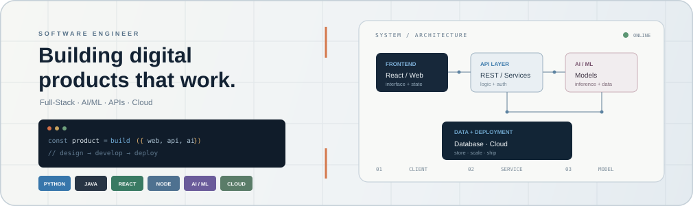

 

  

 

---

## 🧑‍💻 About Me

💻 Developer who loves experimenting with ideas  
🤖 Currently exploring AI, RAG & LLMs  
⚡ Interested in Full-Stack Development  
🌱 Always learning something new  

---

## ⚙️ Tech Stack

### 💬 Languages

### 🎨 Frontend

### 🔧 Backend

### 🗄️ Database & Cloud

### 🧠 AI / ML

### 🛠️ Tools

---

## 🚀 Projects

---

## 📈 GitHub Stats

 

---

## 🏆 Achievements

---

### 🌐 Find me around the internet

&nbsp;&nbsp;

&nbsp;&nbsp;

&nbsp;&nbsp;

  

